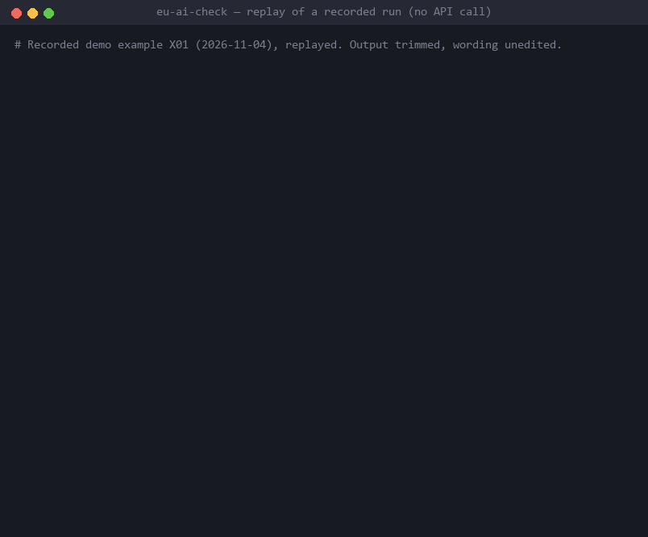
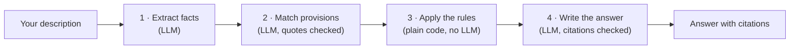

# EU AI Check

[](https://github.com/arnauropero/eu-ai-check/actions/workflows/tests.yml) [](LICENSE) 

**Describe your AI system in plain words. Find out which EU AI Act rules apply to you,
with every answer tied to the exact article it rests on.**



<sub>The GIF replays two recorded runs with no new API call. The wording is
unedited; explanations are trimmed. The five full examples are in
[docs/demo.md](docs/demo.md).</sub>

## What it does

You describe a system ("we built a tool that places students in course levels…") and
a date. It answers four questions about the EU AI Act (Regulation (EU) 2024/1689):

| Question | Possible answers |
|---|---|
| Is it high-risk? (Article 6, Annex III) | applies / does not apply / could not be determined |
| Is it a prohibited practice? (Article 5) | same |
| Are you its provider, its deployer, or both? | same |
| Which provider (Article 16) and deployer (Article 26) obligations apply? | same, with the obligations quoted |

Each answer cites the provisions it rests on. If the description does not say enough,
the answer is **"could not be determined"**, with a list of what it would need to
know. It does not guess.

It is a portfolio project, not legal advice. It covers only the provisions above and
reads the Act as published on 2024-08-01, with no later amendments.

## How it works



1. **Extract facts.** A model turns the description into fixed facts: who built it,
   who uses it, what it does, the date. It may not draw legal conclusions.
2. **Match provisions.** A model checks the description against every candidate
   provision in scope. It must quote both the description and the Act; code verifies
   the quotes and downgrades any verdict that fails.
3. **Apply the rules.** Ordinary code turns facts and verdicts into the four answers:
   dates of application, roles, which obligations follow. No model is involved.
4. **Write the answer.** A model writes short explanations. Code sets every status
   and citation and checks the text; if a check fails, a plain template answer is
   shown instead.

The legal decisions live in code that can be read and tested, and the models are
only asked to read text.

## Results

The final evaluation was **pre-registered**: the cases, pass thresholds and budget
were committed before the first model call. It ran once, on 20 cases never used
during development, and **passed all four gates**.

| Gate | Result | Needed |
|---|---|---|
| G1: no unsafe error, e.g. a definite answer where it should say "could not be determined" | 0 violations | 0 |
| G2: every answer passes the format checks, and every citation quotes the real Act text | 20/20 | 20/20 |
| G3a: risk tier and prohibited practice correct | 20/24 | ≥ 19/24 |
| G3b: roles and Article 16/26 obligations correct | 34/36 | ≥ 33/36 |
| G4: high-risk answers cite exactly the expected legal grounds | 10/10 | no mismatch |

- **All 13 misses were cautious:** "could not be determined" where a definite answer
  was expected. None was a definite answer that contradicted the label.
- **The margins are thin.** G3a and G3b passed with one miss to spare, and G2 passed
  only because one case succeeded on its last allowed retry after network errors.
- **A run costs about $0.08** (three model calls, `gpt-6.1-sol`). The whole final
  phase cost about $3.

Full numbers, confidence intervals and how to reproduce the run:
[docs/evaluation.md](docs/evaluation.md).

## Limitations

The four that matter most:

- **Over-cautious on social scoring (Article 5(1)(c)).** It often answers "could not
  be determined" where a lawyer would decide. This caused 6 of the 13 misses. The
  project's Phase 3 target on this point was not met, and the gap was kept as a
  documented limitation.
- **The checks verify citations, not reasoning.** Code confirms that every quote and
  citation is real, but not that applying the provision is correct. Demo example X05
  cites Article 6(3)(b) on facts that do not support it, and passes every check.
- **A prohibited system still gets a high-risk verdict and obligations.** Since a
  post-evaluation fix, the answer opens by saying the practice is prohibited and
  marks those sections "for reference only" (demo example X04), but the statuses
  themselves are unchanged.
- **Small, self-written test set.** The 12 scored cases were written by the author
  with Claude Code. The intervals are wide, and a misreading of the Act shared by the builders and the
  labels would not show up.

All of them: [docs/limitations.md](docs/limitations.md).

## Try it

You need [uv](https://docs.astral.sh/uv/) and your own OpenAI API key. The project
ships no key and runs no hosted service.

```bash
uv sync
export OPENAI_API_KEY=...        # PowerShell: $env:OPENAI_API_KEY="..."
uv run eu-ai-check assess "We run a chain of language schools. We built a tool that places each new student in a course level from an online test. Which AI Act rules apply to us on 1 November 2026?"
```

- `--date YYYY-MM-DD` sets the assessment date (default: today). A date in the
  description takes precedence.
- `--max-cost` (default $0.75) caps the run. The worst case is checked before the
  first call, and every call is guarded, so a run cannot exceed the cap.
- `assess` writes no files.

No key? Read the [recorded demo](docs/demo.md).

## How it was built

The project ran in six phases. Each phase fixed its acceptance criteria before its
run, and is tagged `phase-N` only if it met them.

| Phase | What | Outcome |
|---|---|---|
| 0 | Legal text: parse the Act into citable provisions | met |
| 1 | Hybrid retrieval over the provisions | met |
| 2 | Fact extraction from free text | met |
| 3 | Grounded determination (rules plus provision matcher) | **not met** (Article 5(1)(c)) |
| 4 | Answer generation with checked citations | met |
| 5 | End-to-end evaluation, demo and `assess` | met |

Retrieval (Phase 1) was built and measured, but the final pipeline does not use it:
the matcher sees every candidate provision, so no answer depends on a search miss
(see [docs/evaluation.md](docs/evaluation.md#pipeline-as-built)).

## Repository guide

| Where | What |
|---|---|
| [docs/demo.md](docs/demo.md) | Five recorded examples, full answers |
| [docs/evaluation.md](docs/evaluation.md) | Final evaluation in full |
| [docs/limitations.md](docs/limitations.md) | Every known limitation |
| [SYSTEM_SPEC.md](SYSTEM_SPEC.md) | Design and the dated record of every decision |
| [PROJECT_PLAN.md](PROJECT_PLAN.md) | Phases and acceptance criteria |
| `src/eu_ai_check/` | Code (`extraction`, `determination`, `generation`, `e2e`) |
| `data/corpus/` | The frozen legal text |
| `data/eval/` | Evaluation cases and results |
